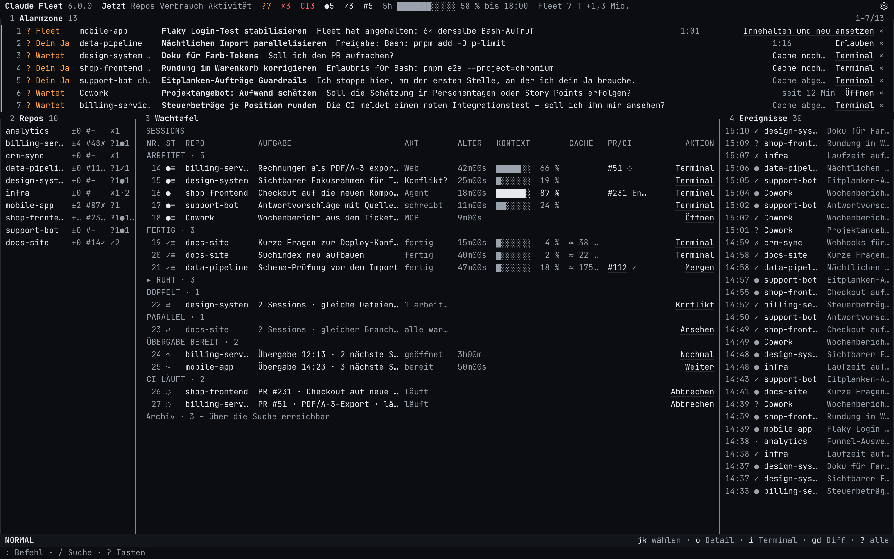
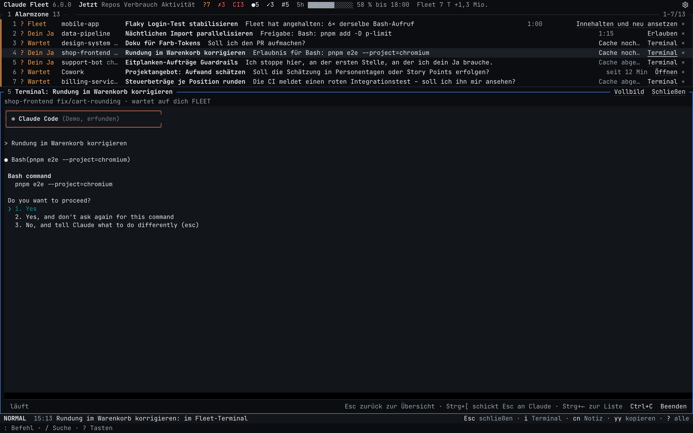
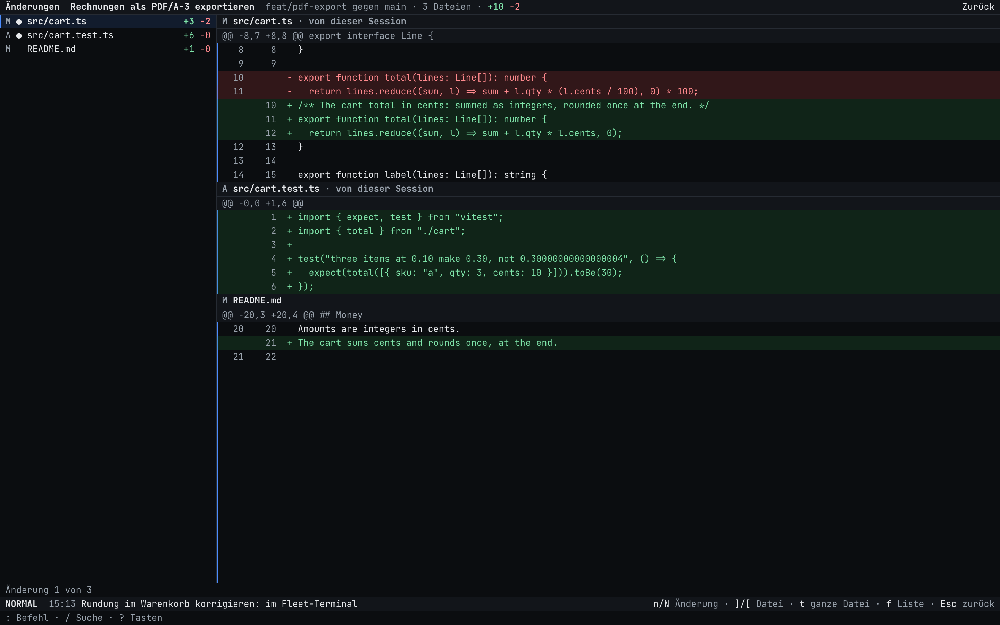
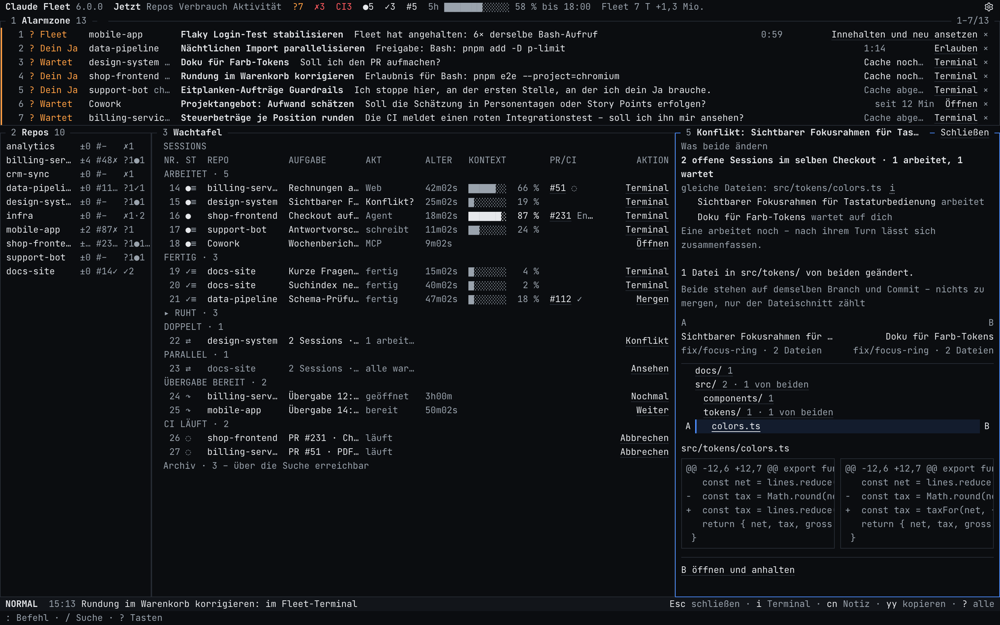
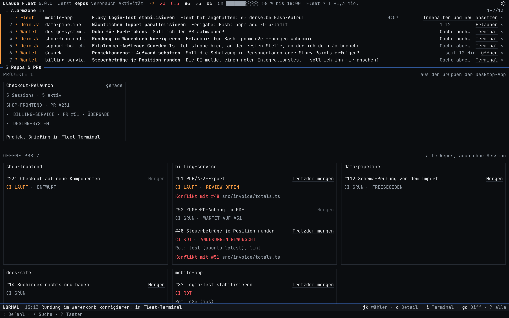
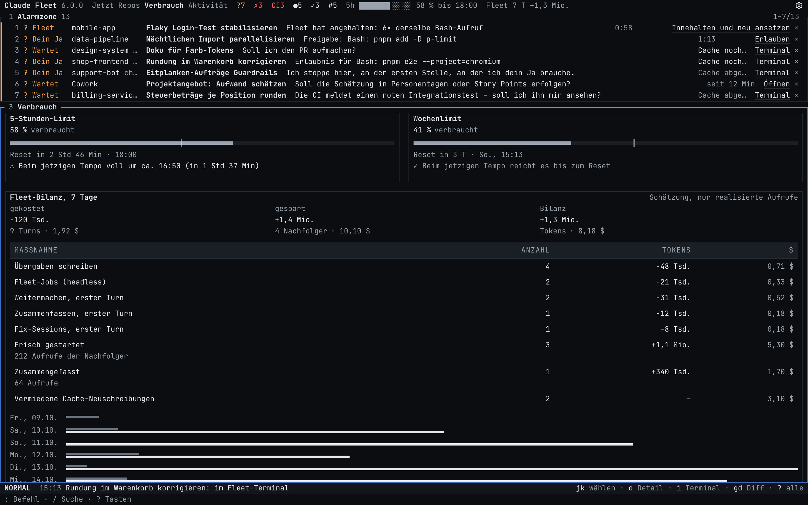
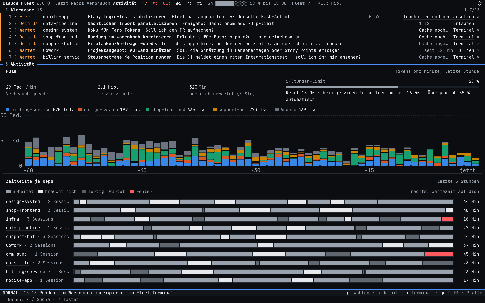
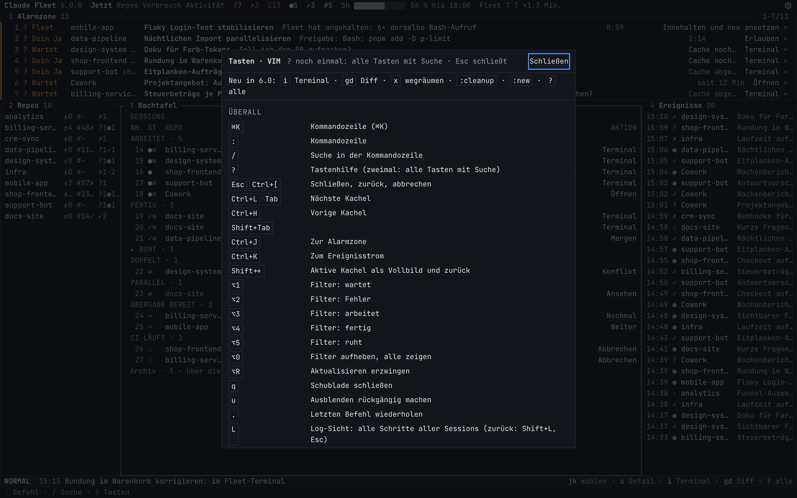
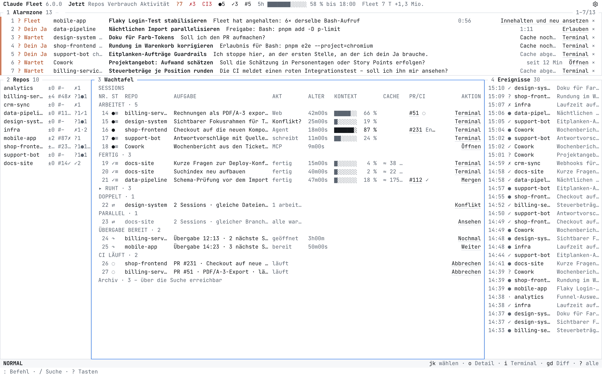

<h1 align="center">Claude Fleet</h1>

<p align="center">
  <b>Ein Schirm für alle Claude-Code-Sessions auf deinem Rechner.</b><br>
  Wer arbeitet, wer fertig ist, wer auf dein Ja wartet – und wo Tokens verloren gehen.
</p>

<p align="center">
  <a href="#schnellstart">Schnellstart</a> ·
  <a href="#was-es-kann">Was es kann</a> ·
  <a href="#tasten">Tasten</a> ·
  <a href="#befehle">Befehle</a> ·
  <a href="#wie-es-gebaut-ist">Wie es gebaut ist</a> ·
  <a href="#sicherheit">Sicherheit</a> ·
  <a href="#grenzen">Grenzen</a> ·
  <a href="README.md">English</a>
</p>



> **Claude Fleet** ist ein lokales Dashboard für alle, die mehrere Claude-Code-Sessions parallel über verschiedene
> Repos laufen lassen – in der Desktop-App, in VS Code oder im Terminal. Bei fünf Agenten gleichzeitig geht der
> Überblick verloren: einer wartet seit zwanzig Minuten auf ein Ja, einer ist längst fertig, einer liest bei jedem
> Aufruf 800 Tsd. Tokens Kontext neu. Fleet beantwortet auf einen Blick: *Wer braucht mich gerade?* und *Wird mein
> Kontingent sinnvoll eingesetzt?*

## Warum

| An echter Arbeit gemessen | |
|---|---|
| ≈ 94 $ von 378 $ | gab eine echte Session für 25 komplette Cache-Neuaufbauten aus – deshalb setzt Fleet auf *Frisch starten* mit Übergabe |
| 2 von 205 Aufträgen | wären mit Modell-Routing je Auftrag an ein anderes Modell gegangen, deshalb verworfen |
| 2 Stopps in 5.077 Aufrufen | die Schleifen-Bremse, an echten Werkzeugaufrufen nachgespielt |
| ≈ 40 ms | kostet der Hook je Werkzeugaufruf (Median) |

- **Nur lokal.** Läuft auf `127.0.0.1`, liest die Dateien von Claude Code nur lesend und lässt nur deinen verbundenen
  Browser an die API.
- **Keine Laufzeit-Abhängigkeiten.** Die gebaute Version (`dist/`, `build/client/`) läuft allein mit Node; die CI
  beweist das bei jedem PR ohne `pnpm install`. Einzige, optionale Ausnahme ist das Terminal (siehe
  [Entscheidungen](#entscheidungen)).
- **Windows, macOS und Linux**, Node.js ≥ 18 und Git.

## Schnellstart

| Voraussetzung | Wofür |
|---|---|
| **Node.js ≥ 18** und `corepack` | Server und Build |
| **Git** | Branches, Diffs, Konfliktprüfungen |
| **Claude Code** (`claude`, angemeldet) | die Sessions, die Fleet beobachtet; das Terminal im Fenster startet es |

```bash
corepack enable && pnpm install && pnpm build   # einmalig
node dist/fleet.cjs serve --demo --open         # ausprobieren mit erfundenen Sessions, fasst ~/.claude nicht an
node dist/fleet.cjs setup                       # echt einrichten: Hooks, Autostart, Befehl `fleet`, Dashboard öffnen
```

Danach in jedem Ordner: **`fleet`**. Fleet startet bei Bedarf und öffnet sich für diesen Ordner – sein Repo ist
gewählt, in einem Ordner ohne Sessions steht „Claude hier starten“ (`:here [Auftrag]`). `fleet ~/code/x` nennt den
Ordner.

`setup` trägt Hooks und Statuszeile ein, richtet den Autostart ein (LaunchAgent, `systemd --user`, Autostart-Ordner
von Windows) und lässt Fleet unsichtbar im Hintergrund laufen; nach einem Absturz startet es sich selbst neu.
`start.cmd` (Windows) oder `./start.sh` (macOS/Linux) tun nach dem Bauen dasselbe. Laufende Sessions einmal neu
starten, damit sie die Hooks laden. Startet etwas nicht, steht der Grund in `~/.claude-fleet/fleet.log`.

## Ansichten

<table>
  <tr>
    <td width="50%"><br><b>Terminal</b> – das echte <code>claude</code> im Vollbild; <code>Esc</code> führt zurück.</td>
    <td width="50%"><br><b>Diff</b> – was eine Session geändert hat, ihre Dateien zuerst.</td>
  </tr>
  <tr>
    <td><br><b>Konflikte</b> – was zwei Sessions beide geändert haben, nebeneinander.</td>
    <td><br><b>Repos &amp; PRs</b> – jeder offene PR mit CI, Review und Konflikten.</td>
  </tr>
  <tr>
    <td><br><b>Verbrauch</b> – Limits, Fleet-Bilanz, Tokens pro Tag.</td>
    <td><br><b>Aktivität</b> – Zeitleiste je Repo und Wochenbericht.</td>
  </tr>
  <tr>
    <td><br><b>Tastenhilfe</b> – die Tasten für die aktuelle Stelle.</td>
    <td><br><b>Hell</b> – derselbe Schirm im hellen Modus.</td>
  </tr>
</table>

## Was es kann

### Sehen, was dich braucht

- **Ein Schirm wie im Terminal.** *Jetzt* füllt genau das Fenster und scrollt nie; gescrollt wird nur in einer
  Kachel. Jede Zeile trägt eine Nummer, jede Session steht an genau einem Ort. Schmale Fenster zeigen eine Kachel auf
  einmal.
- **Alarmzone** (Kachel 1, auf jeder Ansicht): nur, was eine Entscheidung braucht – Fragen von Fleet (Freigaben,
  Bremse), Sessions mit Fehler, Sessions, die auf dein Ja warten, rote CI ohne Fix-Session, Limit über 90 %. Je
  Eintrag eine Zeile, die Ursache in einem Satz, genau eine Aktion; `x` (oder `×`) räumt sie weg. Sechs Zeilen, mehr,
  solange Sessions warten (bis zur halben Fensterhöhe), darüber hinaus scrollt sie in sich. Eine Freigabe, die Fleet
  hält (Zeile mit Countdown), beantworten `y` (erlauben), `a` (für diese Session) und `n` (ablehnen) sofort; Enter fragt
  erst y/n. Hält die Desktop-App die Freigabe, öffnet Enter die Session dort („In der App
  öffnen“); bei einem anderen Terminal sagt Enter, wo sie wartet. `y`/`a`/`n` sagen dasselbe – Fleet kann sie dort nicht
  beantworten und setzt eine solche Session nie als Zweig im Fleet-Terminal fort. Im Vim-Modus fragt Enter y/n.
- **Repo-Leiste** (Kachel 2): je Repo eine Zeile mit lokalen Änderungen, offenen PRs mit CI und Sessions nach Status;
  ein Klick filtert alles außer den Alarmen.
- **Wachtafel** (Kachel 3): eine Zeile je Session mit Repo, Branch, Aufgabe, Statuszeichen, Alter, Kontext-Balken,
  Cache-Rest, PR/CI und einer Aktion; gruppiert nach Arbeitet, Fertig, Ruht.
- **Ereignisstrom** (Kachel 4) der Statuswechsel, an seiner Stelle die **Schublade** (Kachel 5) mit den Details einer
  Session.
- **Wartet und Fehler getrennt.** Endet ein Turn mit einer Frage oder der Bitte um ein Ja, steht die Session als
  *wartet auf dich*, nicht als fertig. Abgelaufene Anmeldung, Limit-Treffer, Ausgabenlimit, API-Fehler, abgestürzter
  Prozess oder kein Lebenszeichen werden zu *Fehler*, jeweils mit der passenden Aktion (*Neu anmelden*, *Fortsetzen*,
  *Limit anheben*, *Neu starten*). Wie Fleet das sicherstellt: [Wartet ist ein geprüftes
  Versprechen](#wartet-ist-ein-geprüftes-versprechen).

### In Sessions arbeiten

- **In jede Session, im Vollbild.** `i` (Standard `→`) auf jeder Zeile, die für eine Session steht – Alarmzone,
  Wachtafel, Ereignisstrom, Verlauf, Verbrauch, ihre Schublade – öffnet ihr Terminal mit den Tasten darin. `Esc` führt
  zurück, die Session läuft weiter; Claudes eigenes Esc ist `Ctrl+[`. Es ist das echte `claude`, jeder Befehl geht
  dort, auch `/remote-control`.
- **Claude im Fenster.** Fleet startet `claude` selbst; die Session läuft weiter, wenn der Tab zu ist. Sie wartet nie
  ungesehen: kein Hook 10 s nach dem Start (Ordner-Vertrauen, Theme, Anmeldung …) oder 10 s Stille, während der Hook
  „arbeitet“ sagt, steht als *wartet* mit „bitte ansehen“. Eigene Tasten beantworten eine Frage sofort; antworten geht
  auch aus der Zeile. Übergaben können als Hintergrund-Job laufen.
- **Was eine Session geändert hat.** `gd` (Standard `d`) oder `:diff`: der Checkout gegen die Abzweigung vom
  Standard-Branch, mit ungespeicherten und neuen Dateien, ihre eigenen Dateien zuerst, rot und grün mit Zeilennummern.
  `n`/`N` laufen durch die Änderungen, `]`/`[` durch die Dateien, `t` zeigt eine ganze Datei, `/` sucht. Auch Dateien,
  die sie außerhalb des Repos bearbeitet hat.
- **Log-Sicht.** `Shift+L` zeigt jeden Schritt jeder Session live in einer Liste, farbig nach Session; eine
  Zeilennummer engt sie auf eine Session ein.
- **Neue Arbeit und Aufräumen.** `:new <name> [Auftrag]` legt einen Projektordner an (mit `git init`) und startet dort
  Claude. `:cleanup` blendet Sessions aus, die seit 8 Stunden still sind (eine ausgeblendete steht wieder da, sobald
  sie wieder arbeitet), `:tidy <repo>` macht das für ein Repo, `:stop` beendet alle Sessions im Fleet-Fenster.
- **Parallele Sessions in Worktrees.** Eine zweite Session in einem Repo, während die erste in seinem Ordner arbeitet
  oder wartet, startet in einem eigenen Git-Worktree neben dem Repo (`<repo>.wt/<auftrag>-<kürzel>`, Branch
  `fleet/<auftrag>-<kürzel>`); keine sieht die Änderungen der anderen. `:wt <repo> [Auftrag]` macht es ausdrücklich.
  Die Zeile zeigt `⎇ <name>` hinter dem Repo. Pro Repo kann die Config einen Einrichtungsbefehl und mitzukopierende
  ignorierte Dateien nennen. `:cleanup` bietet danach die erledigten Worktrees an (Branch gemergt, nichts offen,
  keine Session darin) und entfernt sie mit `y`.

### Tokens gut einsetzen

- **Frisch starten.** Große Kontexte sind der größte Kostenfaktor. Die Session schreibt zuerst eine echte Übergabe
  (Ziel, Erledigt, Offen, nächste Schritte), danach öffnet Fleet eine neue im selben Ordner – im eigenen Terminal, in
  der Desktop-App, in VS Code/Cursor oder im Terminal. **Automatische Übergabe**, wenn Limit oder Kontext knapp werden,
  dazu eine Notfall-Übergabe aus dem Transcript, falls ein Turn abbricht. In der Desktop-App benennt die neue Session
  die alte um („· abgelöst <Tag>“) und archiviert sie (`autoHandoff.archivePredecessor`, Standard an).
- **Bremse.** Vor dem nächsten Werkzeugaufruf kann Fleet eine Session anhalten (Schleife, Limit fast leer) und dich
  fragen; deine Antwort geht direkt an die wartende Session.
- **Fleet-Bilanz.** Was Fleets eigene Turns kosten (Übergaben, Jobs, erste Turns von Sessions, die Fleet gestartet
  hat), gegen das, was sie sparen (weniger Tokens je Aufruf nach Frisch starten oder Zusammenfassen, vermiedene
  Cache-Neuaufbauten), über 7 Tage – und dieselben Frischstarts gegen `/compact` an denselben Stellen. Bei Ben in der
  ersten gemessenen Woche: **+18,71 $** gegen Weitermachen in der alten Session, **−1,30 $ gegen `/compact`**. Gegen
  `/compact` liegt der Wert eines Frischstarts in der lesbaren, bleibenden Übergabe und dem gewählten Zeitpunkt, nicht
  im Geld. `fleet balance` summiert Wochen; mit Pro/Max-Abo zeigt der Kopf das bindende Limit-Fenster statt Dollar.
- **Verbrauch und Aktivität.** Limits so, wie Claude Code sie meldet (keine geschätzten Prozent), Tokens pro Tag nach
  Modell oder Projekt, wo Tokens verloren gehen; eine Zeitleiste je Repo und ein **Wochenbericht** (Markdown oder JSON,
  unter 5 Tsd. Tokens) für eine Claude-Session: Sessions, häufige Alarme, liegengebliebene PRs, Cache-Neuaufbauten,
  Haiku-Kandidaten, Doppelt-Fälle.

### Git und PRs

- **Repos & PRs.** Branch, ungesicherte und nicht gepushte Änderungen, PR mit Review und CI für GitHub, GitLab, Azure
  DevOps und Bitbucket Cloud. Alle offenen GitHub-PRs je Repo, auch ohne Session, mit *Mergen*: die Rückfrage nennt PR,
  Zielbranch und Commits; bei roter, laufender oder fehlender CI nur *Trotzdem mergen* nach einem zweiten Klick;
  Entwürfe und gestapelte PRs warten.
- **Konflikte.** *Doppelt* nur, wenn Sessions dieselben Dateien geändert haben; gleicher Branch oder gleiche Aufgabe
  allein steht grau unter *Parallel*. Offene PRs eines Repos werden alle 5 Minuten paarweise probegemergt
  (`git merge-tree`, ohne Fetch, Arbeitsbaum unberührt) und zeigen *Konflikt mit #n*. Die Konflikt-Schublade zeigt
  einen Ordnerbaum mit A/B-Markierung, die Änderungen beider Seiten und die Auswege.

### Für lange Tage gebaut

- Tastatur zuerst, **Vim als Standard** ([Tasten](#tasten)); jede Taste führt dieselbe Aktion aus wie ein Knopf.
- Deutsch und Englisch, dunkel und hell, eine Monospace-Schrift auf einem 20-px-Raster.
- Per Tastatur und Screenreader bedienbar (axe, WCAG 2.1 AA).

### Wartet ist ein geprüftes Versprechen

Eine Session, die auf dich wartet, steht als *wartet*:
- eine Frage oder ein Plan in der App (AskUserQuestion, ExitPlanMode, Ordner- oder Zugriffsanfrage);
- eine Freigabe, auch nach Ablauf der Bremse, auch die eines Subagenten;
- die Frage-Box der Desktop-App und ihre Karte „Neue Session oder hier?“;
- eine Schlussfrage im Text, auch vor einer Zeile „Festgehalten: …“;
- all das auch über Nachrichten, die die App selbst einschiebt (CI-Monitor, Neben-Sessions, andere Sessions,
  Task-Meldungen), eine Kompaktierung oder ein Resume hinweg.

Jede Art zu warten ist eine Zeile in `tests/waiting-cases.test.ts`, geprüft nur mit Hooks, nur mit Transcript und mit
beidem.

- `fleet compat` prüft jede Version von Claude Code, die im Einsatz ist (das Transcript nennt sie): ein Nachspielen
  durch die echte Erkennung, das Transcript-Format und ob `claude` jeden Schalter noch annimmt, den Fleet übergibt. Der
  Server führt es alle 6 h aus und warnt in der Meldungszeile, wenn die neueste Version etwas bricht.
- `fleet audit [--hours 48]` spielt deine eigenen lokalen Transcripts und Hook-Ereignisse durch denselben Code. Es
  listet jeden Moment, in dem eine Session wartete, Fleet es aber nicht gezeigt hätte, jeden Fehlalarm und Sessions,
  die der Hook meldet, die aber kein Transcript haben (dort kennt Fleet nur den Hook) – nur IDs, Arten und Zeiten, nie
  Text. Es liest nur.

## Tasten

Jede Ansicht und jede Schublade geht per Taste. `?` zeigt die Tasten für die aktuelle Stelle, `??` alle, und die
Statuszeile nennt immer die fünf Tasten der aktiven Kachel. Destruktive Tasten fragen `y/n` in der Statuszeile.

| | Vim-Modus (Standard) | Standardbelegung |
|---|---|---|
| Bewegen | `j` `k`, `gg` `G`, `Ctrl+D` `Ctrl+U` | Pfeile, `j` `k` |
| Zwischen Kacheln | `Ctrl+H` `J` `K` `L` | `1`–`5`, `Tab` |
| Schublade öffnen | `Enter` | `Enter` |
| Ins Terminal der Session | `i` | `→` |
| Was sie geändert hat | `gd` | `d` |
| Ihren PR mergen | `gm` | `m` |
| Zeilen markieren, wiederholen | `V`, `.`, Zähler | – |
| Statusfilter | `Alt+1`–`5` | `Alt+1`–`5` |
| Aktive Kachel im Vollbild | `+` | `+` |
| Befehle, Suche | `:` oder `⌘K`, `/` | `:` oder `⌘K`, `/` |

Der Vim-Modus kennt NORMAL, INSERT, COMMAND und VISUAL; `:mode standard` schaltet um. Die Kommandozeile nimmt `:now`,
`:repos`, `:usage`, `:activity`, `:12` für Zeile 12, `merge 8` für PR #8, `report week` und mehr.

## Befehle

| Befehl | Was er tut |
|---|---|
| `fleet [Ordner]` | bei Bedarf starten und für diesen Ordner öffnen |
| `node dist/fleet.cjs setup [--uninstall]` | Hooks, Statuszeile, Autostart, Befehl `fleet` – oder alles wieder entfernen |
| `node dist/fleet.cjs open` | bei Bedarf starten und in einem verbundenen Browser öffnen (anderer Browser, neues Profil) |
| `node dist/fleet.cjs status \| stop \| restart` | der Hintergrund-Server; mit Sessions im Fenster: `--force` (sie enden) |
| `node dist/fleet.cjs install-hooks [--light] [--no-brake] [--no-statusline] [--uninstall]` | nur die Hooks |
| `node dist/fleet.cjs hook status \| off \| on` | Notschalter für den Hook in allen Sessions, ohne Neustart |
| `node dist/fleet.cjs serve --demo --open` | Demo mit erfundenen Sessions |
| `fleet audit [--hours 48]` | hat Fleet jedes Warten gezeigt? (nur lesend) |
| `fleet compat` | passt Fleet zu den Versionen von Claude Code im Einsatz? |
| `fleet balance` | Fleets Kosten gegen das Gesparte, nach Wochen |
| `fleet scope --days 14` | welche Funktionen ungenutzt blieben |

### Konfiguration

Optional: `config.example.json` nach `~/.claude-fleet/config.json` kopieren. Ungültige Werte werden begrenzt und als
Hinweis gezeigt.

| Einstellung | Wofür |
|---|---|
| Port, Session-Alter, PR-Aktualisierung, `staleMinutes` | der Server und wann eine Session als still gilt |
| weitere Repos, ausgeblendete Projekte, `cloudSessions` | welche Repos und Sessions Fleet zeigt |
| `hostMap` | selbst betriebene Git-Server |
| Zugangstokens | nur lesend: `GITHUB_TOKEN`, `GITLAB_TOKEN`, `AZURE_DEVOPS_PAT`, `BITBUCKET_TOKEN`; ohne GitHub-Token nimmt Fleet `gh` |
| `billing` | `subscription` oder `api` |
| `brake`, `autoHandoff` | Schwellen, oder abschalten |
| `language` | `"de"` oder `"en"` |
| `worktree` | `auto`: `second` (Standard), `always` oder `off`; `fetch` vor einem neuen Worktree; pro Repo `setup` und `include` |

## Umfang

Eingefroren seit 6.0.0: Fleet wächst nur noch durch Fehlerbehebungen ([docs/SCOPE.md](docs/SCOPE.md)). Es zählt
lokal, welche Funktionen benutzt werden (`~/.claude-fleet/feature-use.json`, Zähler je Tag, nie Text);
`fleet scope --days 14` zeigt, was ungenutzt blieb – die ersten Kandidaten zum Streichen. Ein Test hält den Quellcode
im Budget von `size-budget.json`.

## Wie es gebaut ist

Aufbau, Ordner und Diagramm stehen ausführlich in der [englischen README](README.md#how-its-built). Kurz:

| Ordner | Was dort liegt |
|---|---|
| `app/` | Oberfläche mit React Router 7 (SPA), TypeScript strict, Tailwind; eine Datei pro Route, Komponenten nach Bereich (`screen/` für den Rahmen: Kachel, Kopf-, Meldungs-, Status- und Kommandozeile). Tasten nur in `lib/keymap.ts`, Kacheln nur in `lib/tiles.ts`, Farben und Schrift nur in `tokens.css`. |
| `server/` | eigener `node:http`-Server: `core` (Transcripts, Status, Verbrauch, Bilanz, Berater, Git, Konflikte), `handoff` (Übergaben in einzelnen Schritten), `process` (Claude im Fenster, Jobs), `http` (Sicherheit, API, CSP) und `cli`. |
| `hooks/` | Hook, Statuszeile und Starter – klein, schnell, werfen nie, enden immer mit Exit-Code 0. |
| `scripts/bundle.ts` | esbuild bündelt Server, CLI und Hooks zu `dist/*.cjs`, die nur Node-Bordmittel brauchen; Abhängigkeiten gibt es nur beim Bauen. |

**Der Schirm.** Jede Ansicht ist genau so hoch wie das Fenster: Kopfzeile, Meldungszeile, Alarmzone, die Kacheln der
Mitte, Statuszeile, Kommandozeile. Eine Kachel ist eine Rahmenzeile mit Nummer und Name und ein Körper, der selbst
scrollt.

Alles liegt auf einem Zeichenraster: JetBrains Mono 13 px, jede Zeile 20 px, Spalten in `ch`.
- **Status** ist ein Textzeichen neben seinem Wort: `?` wartet, `●` arbeitet, `✓` fertig, `✗` Fehler, `·` ruht.
- **Knöpfe und Tags** sind Text, und Abschnitte sind eine 1-px-Linie.
- **Kein Schmuck:** keine Karten, Rundungen, Schatten oder Icons außer hinter dem Zahnrad.
- **Eine Bewegung:** ein neues `?` oder `✗` in der Alarmzone blinkt dreimal.

### Entscheidungen

| Entscheidung | Warum |
|---|---|
| Bündeln auf Node-Bordmittel, Abhängigkeiten nur beim Bauen | Ein Werkzeug, das Hooks in jede Claude-Session hängt, soll keine Lieferkette mitbringen. Entwickler bekommen React, Tailwind, Vitest und Playwright; Nutzer bekommen vier `.cjs`-Dateien und statische Dateien. |
| Das pty-Modul ist die einzige optionale Abhängigkeit | Ein echtes Terminal braucht ein Pseudo-Terminal, das Node nicht hat. `@lydell/node-pty` bringt vorgebaute Binärdateien mit (kein node-gyp, kein Install-Skript), wird erst zur Laufzeit geladen und nie gebündelt. Fehlt es, läuft alles außer dem Terminal, und Fleet nennt den Grund. |
| React Router als SPA, eigener `node:http`-Server | Kein Framework-Server zur Laufzeit; der Server liefert den gebauten Client mit strikter CSP und eine kleine JSON-API. Terminal-Ausgabe läuft über Server-Sent Events, Eingabe per POST durch dieselbe Prüfung – Node hat keinen eingebauten WebSocket-Server. |
| Leitstand statt Kartenwand | Bei vielen Sessions zählt *was braucht mich*, also steht nur das oben (Alarmzone, nach ISA-18.2: selten mehr als eine Handvoll Einträge). Alles andere ist eine Tabellenzeile, Erklärungen sind Tooltips, Details liegen eine Ebene tiefer in der Schublade. Eine Session steht an einem Ort, ein Signal erscheint einmal. |
| Ein Schirm im CLI-Look | Ein Leitstand, den man scrollen muss, ist keiner. Ein festes Zeichenraster macht jede Zeile gleich hoch und jede Spalte bündig, so ist ein Blick über 30 Sessions ein Blick eine Spalte hinunter; Textzeichen ersetzen die Schiffe, die eine Legende brauchten und sich bewegten. Nummerierte Kacheln machen jeden Ort mit einer Taste erreichbar; die Kommandozeile ersetzt vier Bereichstasten und ein eigenes Suchfeld. |
| Grau als Normalfall, strenge Farbgrammatik | Farbe bedeutet nur etwas, wenn sie selten ist. Rot nur für Fehler, rote CI und Merge-Gefahr; Orange nur für *wartet auf dein Ja*; Bernstein nur für Felder, die du bearbeiten kannst. Schwellen sind helleres Grau, Grün gibt es nicht. Tests prüfen die Tokens und den Kontrast in beiden Schemata, auch auf überfahrenen und gewählten Zeilen. |
| *Wartet* aus dem Text des letzten Turns, *Fehler* aus dem Transcript | Claude Code kennt keinen Zustand „braucht Eingabe“, wenn ein Turn mit einer Frage endet. Fleet liest die Schlusszeilen auf eine Frage oder die Bitte um ein Ja und das Transcript auf API-Fehler (Anmeldung, Limit, Ausgaben), die auch beendete Sessions abdecken. Bei Sessions im Fenster liest Fleet den Bildschirm nie: kein Hook 10 s nach dem Start oder 10 s Stille, während der Hook „arbeitet“ sagt, zählt als *wartet* („bitte ansehen“), denn ein verpasstes Warten kostet mehr als ein Blick zu viel. |
| Mergen fragt zweimal, wenn die CI nicht grün ist | Ein Merge lässt sich im Dashboard nicht rückgängig machen. Die Rückfrage nennt PR, Zielbranch und Zahl der Commits; rote, laufende oder fehlende CI braucht einen zweiten Klick auf *Trotzdem mergen*; Entwürfe und gestapelte PRs lehnt auch der Server ab. |
| Tasten in einer Tabelle, dieselben Aktionen wie die Knöpfe | `keymap.ts` ist der einzige Ort, der Tasten kennt, mit einer Spalte für Standard und Vim und einem Test gegen Doppelbelegungen. Tasten führen dieselben Aktionen aus wie die Knöpfe, die Tastatur kann also nichts, was die Maus nicht kann. |
| Fleet legt Worktrees selbst an, neben dem Repo | Mit `git worktree add` statt `claude -w` kennt Fleet den Ordner vor dem Start: Transkript, Fortsetzen und Diff brauchen keinen Sonderfall; die Konfliktprüfung vergleicht Dateien nach ihrem Pfad im Repo, so treffen sich eine Session im Worktree und eine im Hauptordner dort weiter. Neben dem Repo statt darin, damit Linter, Testläufer und Watcher ihn nicht doppelt lesen. Einrichtungsbefehle nur aus der Nutzer-Config, nie aus einer Datei im Repo; Entfernen nur ohne `--force` und mit `git branch -d`. |
| Esc verlässt das Terminal, `Ctrl+[` ist Claudes Esc | In eine Session hinein- und wieder herauszuspringen ist der häufigste Weg; Esc ist die Taste, die die Hand findet. `Ctrl+[` schickt im Terminal dasselbe Byte, es geht nichts verloren; Statuszeile und ein einmaliger Hinweis sagen es, weil Claudes Bildschirm weiter „esc to interrupt“ zeigt. |
| Die Diff-Sicht liest nur | Wie die Konfliktprüfung: kein Fetch, kein Schreiben in Index oder Arbeitsbaum, kein externes Diff und keine Textumwandlung; Dateien nur aus Gits Listen und den eigenen Änderungen der Session, keine Links, mit Größengrenze. Ein veralteter `origin` macht den Diff größer, nie falsch, was eine Datei angeht. |
| Wegräumen heißt ausblenden, und es wacht auf | Fleet löscht keine Transcripts. Eine ausgeblendete Session steht wieder da, sobald sie nach dem Ausblenden arbeitet – ein weggeräumter alter Alarm kann nie eine Session verstecken, die später auf dich wartet. |
| Regeln statt LLM im Berater | Kostet keine Tokens, ist erklärbar und testbar; jeder Hinweis nennt seinen Grund. |
| Nur sichere Zahlen | Die Desktop-App hat keine Statuszeile. Limit-Prozent zeigt Fleet nur von Claude Code selbst und aus dem gemeldeten Treffer; Schätzungen lagen in der Praxis daneben. Die Fleet-Bilanz zählt nur realisierte Aufrufe und sagt, was sie nicht messen kann. |
| Dieselbe Session schreibt ihre Übergabe | Ihr Verlauf liegt schon im Cache (billig zu lesen); ein kleineres Modell müsste alles neu lesen und schriebe eine schlechtere Zusammenfassung. |
| Eine Übergabe wird nur weitergegeben, wenn Fleet sie angefordert hat | Ein `HANDOFF.md` aus einem fremden Repo könnte sonst Anweisungen in neue Sessions schmuggeln. Fleet speichert den SHA-256 jeder angeforderten Übergabe; alles andere wird nur erwähnt. |
| Bremse vor dem Werkzeugaufruf | Nur `PreToolUse` kann mitten im Turn warten und Claude eine Anweisung geben. Ohne Anlass kostet das einen Node-Start: Median ≈ 40 ms (`pnpm hook-latency`). |
| Der Server startet Programme, nie die Seite | Ordner und Session-IDs kommen aus Fleets eigener Übersicht, nicht aus der Anfrage; Prozesse starten aus Argumentlisten, ohne Shell. |
| Konfliktprüfungen fassen deinen Checkout nicht an | `git merge-tree --write-tree` schreibt nur Objekte; Fleet holt nie per Fetch und schreibt nie Index, Refs oder Arbeitsbaum. Die bearbeiteten Pfade der Sessions bleiben auf dem Server. |

## Sicherheit

Das Dashboard zeigt Prompts, Pfade und Antworten, sein Terminal kann in Claude tippen, und es kann freigeben und
mergen – deshalb kann es nur dein verbundener Browser benutzen. Bekannte Grenzen: [SECURITY.md](SECURITY.md).

- **Nur Loopback.** Jede Anfrage braucht einen Host `localhost`/`127.0.0.1`/`[::1]` mit dem richtigen Port
  (DNS-Rebinding).
- **Gleiche Herkunft.** Die API verlangt `Origin` und `Sec-Fetch-Site`; schreibende Anfragen zusätzlich den Header
  `X-Fleet` und JSON (CSRF). Terminal-Eingaben laufen durch dieselbe Prüfung.
- **Ein Token je Browser.** Jede API-Anfrage des echten Fleet braucht ein Token-Cookie (`HttpOnly`, `SameSite=Strict`),
  das ein Browser einmal über den Link bekommt, den `fleet start`/`fleet open` öffnet; das Token liegt in
  `~/.claude-fleet/token` (`0600`). So kann ein anderer lokaler Prozess – etwa eine durch Prompt-Injection übernommene
  Claude-Session mit `curl` – weder seine eigene Freigabe erteilen noch in andere Sessions tippen oder mergen. Nur
  `/api/health` bleibt für Starter offen; die Demo hat keine echten Wirkungen und braucht kein Token.
- **Strikte CSP.** Nur Fleets eigene Skripte per Hash, kein `eval`, keine Inline-Handler, keine Frames. Links müssen
  `http(s)` sein.
- **Tokens bleiben daheim.** Sie gehen nur an bekannte Hosts und deine `hostMap`; Weiterleitungen werden nicht
  verfolgt.
- **Git ohne Shell**, mit geprüften Branch- und Repo-Namen, `core.fsmonitor=false` und ohne optionale Sperren.
- **Ein bewachter Hook.** Der Hook läuft in jeder Claude-Session, deshalb darf ein schlechter Build nicht alle treffen:
  - **Wächter:** `settings.json` startet einen kleinen Wächter in `~/.claude-fleet/hook/`, und der lädt nur eine Kopie
    des Builds, die einen Selbsttest bestanden hat. Ein kaputtes `pnpm build` lässt den letzten guten aktiv.
  - **Neue Builds:** beim Start übernimmt Fleet einen neuen Build nur von einem sauberen `main`, das `origin/main`
    gleicht, damit eine Session, die an Fleet selbst arbeitet, ihren Code nicht in jede Session bringen kann.
    `install-hooks` übernimmt ihn absichtlich.
  - **Abstürze:** jeder Absturz wird Exit 0 und eine Zeile in `hook/errors.jsonl`. Nach 10 Abstürzen in 10 Minuten
    schaltet der Wächter den Hook ab.
  - **Notschalter:** `fleet hook off` hält ihn mit dem nächsten Ereignis in jeder Session an, `fleet hook on` holt ihn
    zurück. Fleet zeigt beides und jeden Absturz in der Meldungszeile.
- **Dateien.** Zustandsdateien sind `0600`/`0700` und werden atomar geschrieben. `~/.claude/settings.json` wird vor
  jeder Änderung gesichert; Hooks anderer Werkzeuge bleiben unberührt.

Restrisiko: `git status` kann in einem Repo eingerichtete Clean-Filter ausführen (z. B. Git LFS) – nur in Repos, in
denen Claude ohnehin arbeitet.

## Grenzen

**Warten und Fehler erkennen**
- Ohne Hooks ist eine wartende Werkzeug-Freigabe nicht von einem laufenden Werkzeug zu unterscheiden. Ausnahme:
  Sessions im Fenster von Fleet, dort bitten 10 s Stille beim Arbeiten oder kein Hook nach dem Start um einen Blick.
- Ein Turn ohne Lebenszeichen über `staleMinutes` (Standard 20) zeigt *keine Rückmeldung* – außer Claude Code meldet
  den Prozess selbst als beschäftigt (`~/.claude/sessions/<pid>.json`); dann bleibt ein langer Werkzeuglauf *arbeitet*.
  Derselbe Prozessstatus klärt, was Hooks verpassen: meldet Claude Code *wartet*, wartet die Session; *idle* heißt,
  der Turn ist zu Ende. Das Format ist nicht dokumentiert; `fleet compat` warnt, wenn Fleet es nicht mehr lesen kann.
- *Wartet auf dich* beruht auf einer Phrasentabelle für Deutsch und Englisch; eine ungewöhnliche Frageform kann als
  *fertig* durchrutschen. `fleet audit` findet solche Fälle in deinem Verlauf; seine Wahrheit für Textfragen ist eine
  eigene, einfachere Regel (Fragezeichen oder ausdrückliche Bitte in den letzten zwei Zeilen) und übersieht, was beide
  Regeln übersehen.
- Die Garantie „wartet“ hat bekannte Lücken, jede in `tests/waiting-cases.test.ts` festgehalten:
  - Ohne Hooks sieht eine wartende Freigabe (auch die eines Subagenten) wie ein laufendes Werkzeug aus.
  - Solange ein eingeschobener Turn der App über einer offenen Frage läuft, steht die Session als *arbeitet*, und die
    Frage kommt an seinem Ende zurück.
  - Eine beendete Session (SessionEnd, z. B. archiviert) wartet auf niemanden.
  - `fleet audit` spielt den Bildschirm von Sessions im Fenster nicht nach, und `events.jsonl` hält nur die lauten
    Hook-Ereignisse; die Werkzeug-Ereignisse rekonstruiert es aus dem Transcript.

**Das Terminal im Fenster**
- Das Terminal braucht die `claude`-CLI, angemeldet, und das optionale pty-Modul. Ist `claude` nicht im PATH, nimmt
  Fleet die neueste CLI, die die Claude-Desktop-App in ihrem Datenordner hält: `claude-code/<version>/<build>/` unter
  `~/Library/Application Support/Claude`, `%APPDATA%\Claude` oder `~/.config/Claude`. Gibt es keine, sagt die
  Meldungszeile, warum.
- Ein Neustart von Fleet beendet die Sessions im Fenster; sie stehen danach als *unterbrochen* mit *Fortsetzen*.
- Antworten aus der Zeile gehen nur an Sessions im Fenster; zur Desktop-App gibt es keine Brücke.
- `--session-id`, `--resume` und Hintergrund-Jobs folgen der heutigen Oberfläche von Claude Code. Ändert sie sich
  (etwa ein Spinner, der beim Arbeiten nicht mehr neu zeichnet), gibt es zusätzliche Alarme „bitte ansehen“. Ohne
  installierte Hooks bittet jede Session im Fenster 10 s nach dem Start um einen Blick.
- Im Fleet-Terminal gehört Esc Fleet; Claudes Esc ist `Ctrl+[`. Tastenkürzel, die der Browser behält (z. B. `⌘W`),
  erreichen Claude nie.
- Freigaben warten nur in Fleet (bis `brake.approvalSeconds`, Standard 45 s), solange ein Fleet-Tab sichtbar und
  fokussiert ist; so lange zeigt die Desktop-App keine eigene Abfrage. Wer den Tab verlässt, sieht die Abfrage in der
  App nach etwa einer Sekunde; ein Tab, der ohne Abmeldung verschwindet (Absturz, Ruhezustand), hält Freigaben noch bis
  zu 40 s.

**Git, Zahlen und der Rest**
- `:cleanup` bietet einen Worktree nur an, wenn sein Branch im Standard-Branch steckt, so wie Fleet ihn sieht (kein
  Fetch): Ein per Squash gemergter Branch oder ein noch nicht geholter Merge bleibt bis `git pull`. Eine eigene
  ignorierte Datei (eine, die der Hauptordner nicht hat, oder eine dort geänderte kopierte Config) hält ihn auch,
  denn Entfernen würde sie löschen. `n` bei der Frage zum Ausblenden überspringt die Worktree-Frage. Von Hand
  angelegte Worktrees fasst Fleet nie an.
- Konfliktprüfungen brauchen Git ≥ 2.38 und sehen nur PR-Branches, die schon im Checkout sind (Fleet holt nie per
  Fetch). Geprüft werden höchstens 12 offene PRs je Repo.
- Der Diff vergleicht mit dem Standard-Branch, wie dein Checkout ihn kennt (Fleet holt nie); Dateien über 512 KB,
  Binärdateien und mehr als 300 Dateien werden gekürzt, und der Diff gehört dem Checkout: zwei Sessions in einem
  Checkout teilen ihn (die eigenen Dateien jeder Session sind markiert).
- Die Fleet-Bilanz ist eine Schätzung gegen einen Fall, der nicht eingetreten ist. Haiku statt Opus, Bremse und
  gestoppte Schleifen sind nicht beziffert; Fix- oder Briefing-Sessions, die in Desktop-App oder VS Code geöffnet
  wurden, zählen nicht. Wie Anthropic Tokens auf das Limit anrechnet, ist unbekannt, deshalb steht die Bilanz in
  Tokens, nicht in Limit-Prozent.
- Ersparnisse des Beraters sind Schätzungen zu Listenpreisen (Oktober 2026).
- Die Bremse greift zwischen Werkzeugaufrufen; ein einzelner langer Aufruf (z. B. ein Testlauf) wird nicht
  unterbrochen.
- Fleet handelt an einigen Stellen selbst (Übergaben an Limit- oder Kontextschwellen, Notfall-Übergaben, Öffnen der
  nächsten Session nach einer Übergabe); jede steht in [`docs/BESTAND-automatiken.md`](docs/BESTAND-automatiken.md) und
  lässt sich mit `autoHandoff.enabled` und `brake.enabled` abschalten.
- Die Session-Daten der Desktop-App und die Transcripts von Claude Code sind interne Formate; Fleet liest sie
  vorsichtig und nur lesend.
- Cloud-Sessions (claude.ai/code) hinterlassen lokal keine Dateien; Hintergrund-Sessions aus `claude agents`
  erscheinen, andere lassen sich unter `cloudSessions` eintragen.
- Fleet 6.0 ist für einen Desktop-Browser gebaut. Auf dem Handy (375 px) taugt es für einen Blick, wer wartet, und um
  einen Vorschlag von Fleet anzunehmen, nicht zum Steuern von Sessions. Zeilen und Kopfzeile sind abgeschnitten,
  Tippziele 20 px hoch, das Terminal hat keine Tastenleiste für Esc, `Ctrl+[` oder `Ctrl+C`, und manche Hinweise
  setzen eine Tastatur voraus. Die Befunde stehen in [`docs/SCOPE.md`](docs/SCOPE.md) unter „Later: phone“.

## Entwicklung

```bash
pnpm dev            # API im Demo-Modus + Vite mit Hot Reload auf http://localhost:5181
pnpm check          # Typen, Biome, Build, Vitest, Playwright + axe
pnpm test           # Vitest: Unit- und Integrationstests gegen den echten gebauten Server, ohne Netz
pnpm test:e2e       # Playwright auf Desktop und Handy, Demo-Modus
pnpm screenshots    # Bilder in docs/ und docs/en/ neu erzeugen
node scripts/smoke.mjs   # das gebaute Release nur mit Node-Bordmitteln
node dist/fleet.cjs audit   # die letzten 48 h deiner Sessions nachspielen: hat Fleet jedes Warten gezeigt? (nur lesend)
```

Die CI auf GitHub Actions läuft bei jedem PR:
- Typen, Lint und Tests unter Linux, macOS und Windows;
- das gebaute Release ohne `node_modules`, auf Node 18, 22 und 24;
- E2E mit axe.

Actions sind auf Commit-SHAs gepinnt, mit Rechten `contents: read`. Mit Claude Code an diesem Repo arbeiten:
[`CLAUDE.md`](CLAUDE.md).

## Lizenz

MIT
