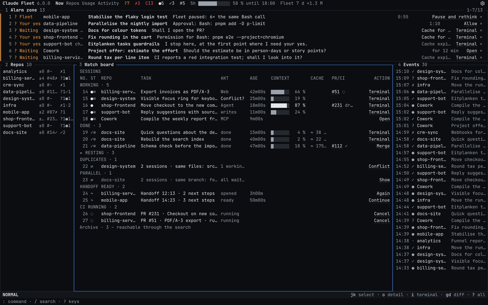
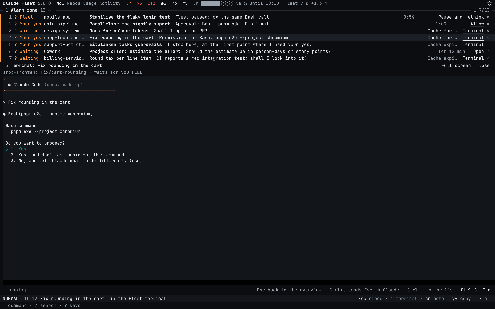
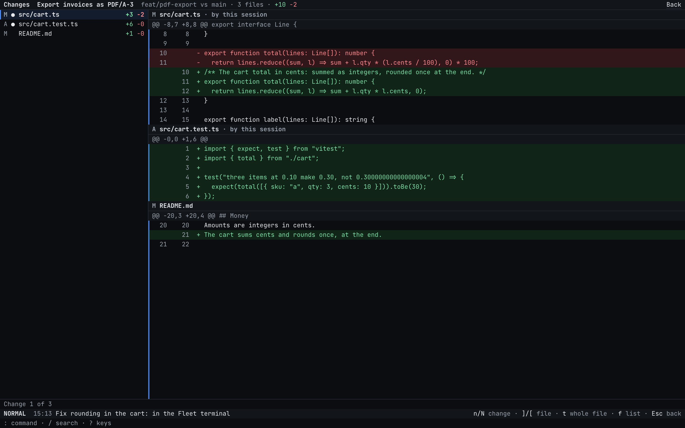
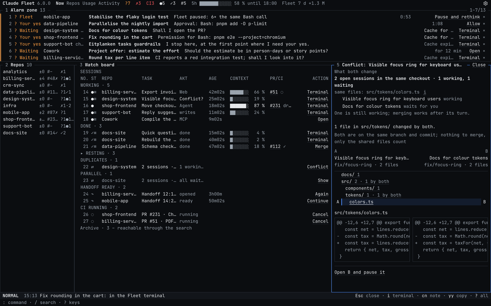
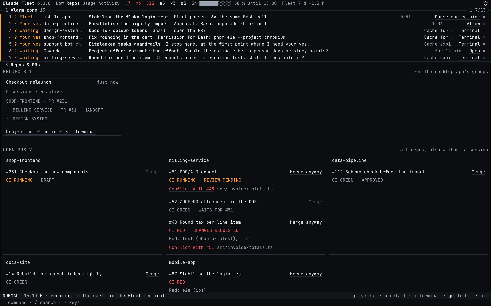
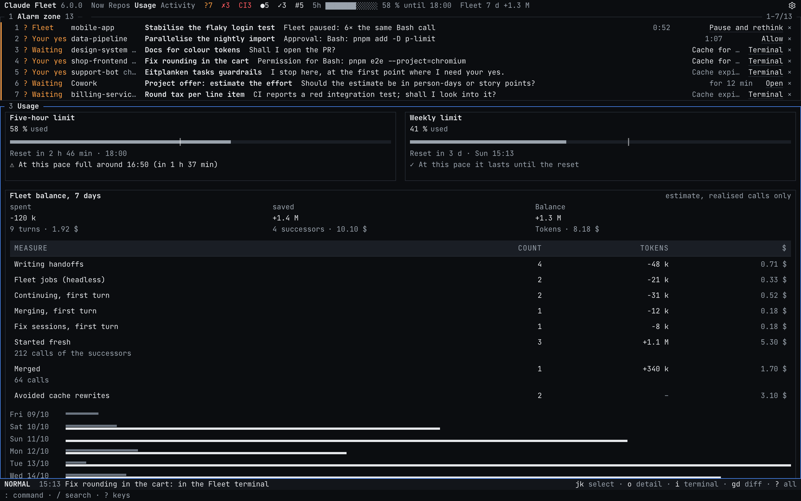
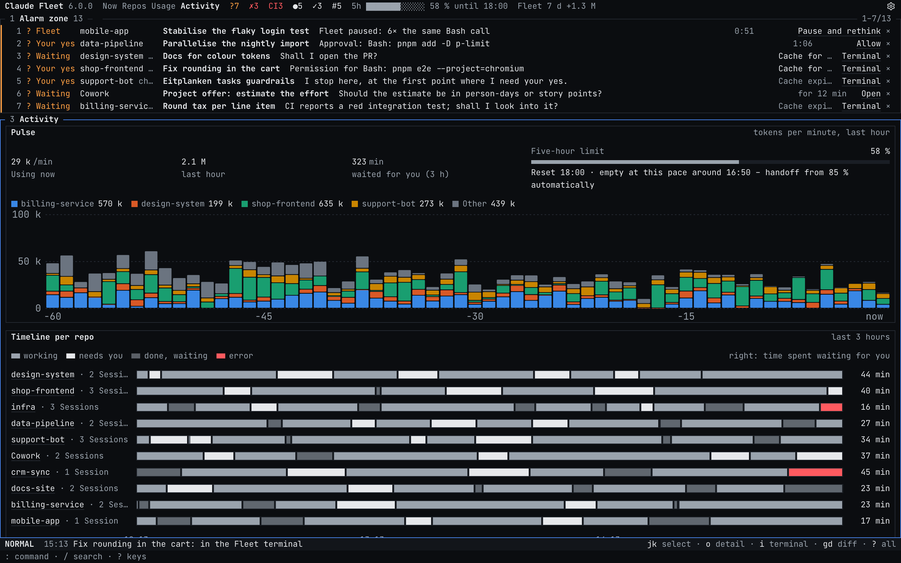
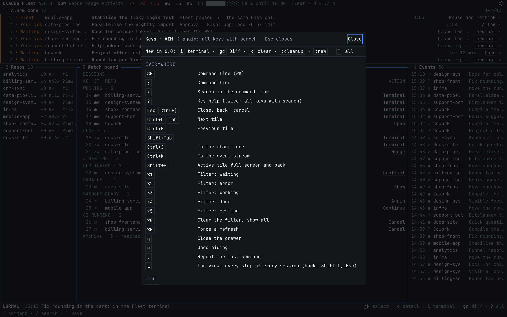
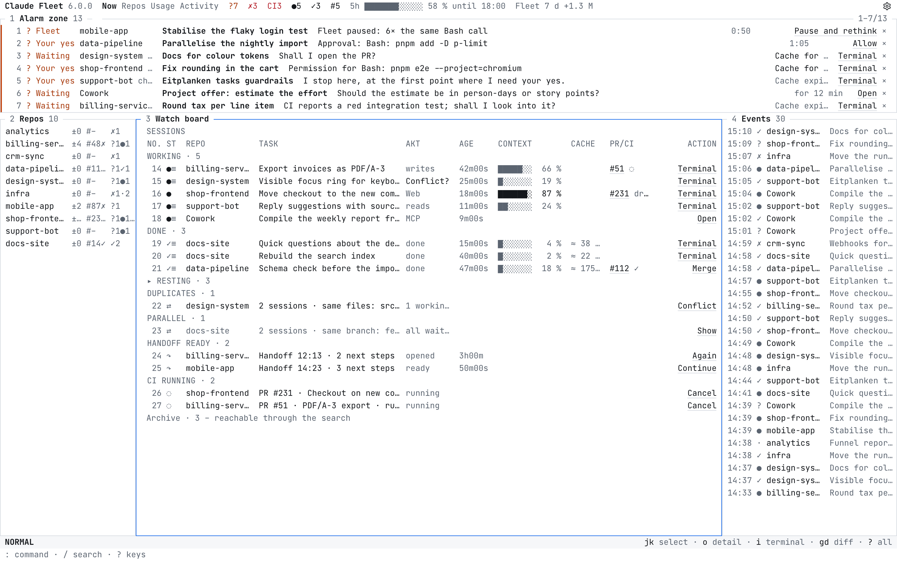
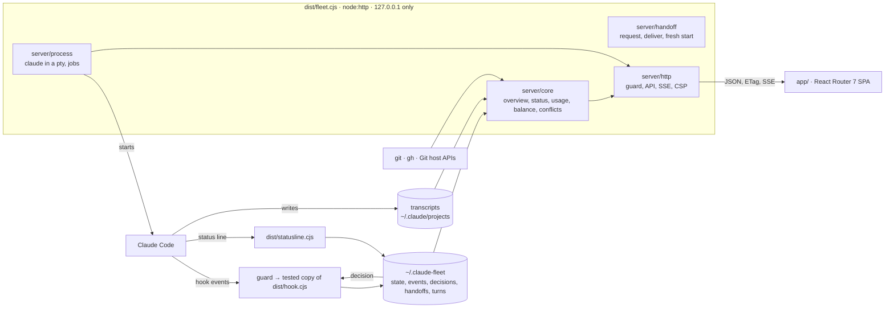

<h1 align="center">Claude Fleet</h1>

<p align="center">
  <b>One screen for every Claude Code session on your machine.</b><br>
  Who works, who is done, who waits for your yes – and where tokens are wasted.
</p>

<p align="center">
  <a href="#quick-start">Quick start</a> ·
  <a href="#features">Features</a> ·
  <a href="#keys">Keys</a> ·
  <a href="#cli">CLI</a> ·
  <a href="#how-its-built">How it's built</a> ·
  <a href="#security">Security</a> ·
  <a href="#limits">Limits</a> ·
  <a href="README.de.md">Deutsch</a>
</p>



> **Claude Fleet** is a local dashboard for anyone who runs several Claude Code sessions in parallel across repos –
> in the desktop app, VS Code or a terminal. With five agents at once you lose track: one waits twenty minutes for a
> yes, one finished long ago, one re-reads 800k tokens of context on every call. Fleet answers two questions at a
> glance: *who needs me right now?* and *is my budget well spent?*

## Why

| Measured on real work | |
|---|---|
| ≈ $94 of $378 | one real session spent this on 25 full cache rebuilds – which is why Fleet focuses on *start fresh* with a handoff |
| 2 of 205 tasks | would have gone to another model with per-task routing, so routing was dropped |
| 2 pauses in 5,077 calls | the loop brake, replayed on real tool calls |
| ≈ 40 ms | what the hook costs per tool call (median) |

- **Local only.** Runs on `127.0.0.1`, reads Claude Code's files read-only, and needs a paired browser for every API call.
- **No runtime dependencies.** The built release (`dist/`, `build/client/`) runs on Node's built-ins alone; CI proves
  it on every PR without `pnpm install`. The one optional exception is the terminal (see [Decisions](#decisions)).
- **Windows, macOS and Linux**, Node.js ≥ 18 and Git.

## Quick start

| Requirement | Why |
|---|---|
| **Node.js ≥ 18** and `corepack` | runs the server, builds the release |
| **Git** | branches, diffs, conflict probes |
| **Claude Code** (`claude`, logged in) | the sessions Fleet watches; the terminal in Fleet's window starts it |

```bash
corepack enable && pnpm install && pnpm build   # once
node dist/fleet.cjs serve --demo --open         # try it with made-up sessions; never touches ~/.claude
node dist/fleet.cjs setup                       # for real: hooks, autostart, the `fleet` command, open the dashboard
```

From then on, in any folder: **`fleet`**. Fleet starts if needed and opens for that folder – its repo chosen, or, in a
folder without sessions yet, "start Claude here" (`:here [task]`). `fleet ~/code/x` names the folder.

`setup` installs the hooks and the status line, sets up autostart (LaunchAgent, `systemd --user`, Windows startup
folder) and runs Fleet invisibly in the background; it restarts itself after a crash. `start.cmd` (Windows) or
`./start.sh` (macOS/Linux) do the same after the build. Restart sessions that were already running so they load the
hooks. If something does not start, the reason is in `~/.claude-fleet/fleet.log`.

## Screenshots

<table>
  <tr>
    <td width="50%"><br><b>Terminal</b> – the real <code>claude</code> full screen; <code>Esc</code> leads back.</td>
    <td width="50%"><br><b>Diff</b> – what a session changed, its own files first.</td>
  </tr>
  <tr>
    <td><br><b>Conflicts</b> – what two sessions both changed, side by side.</td>
    <td><br><b>Repos &amp; PRs</b> – every open PR with CI, review and conflicts.</td>
  </tr>
  <tr>
    <td><br><b>Usage</b> – limits, Fleet balance, tokens per day.</td>
    <td><br><b>Activity</b> – timeline per repo and the week report.</td>
  </tr>
  <tr>
    <td><br><b>Key help</b> – the keys for where you are.</td>
    <td><br><b>Light mode</b> – the same screen in light.</td>
  </tr>
</table>

## Features

### See what needs you

- **One screen, like a terminal.** *Now* fills exactly the window and never scrolls; only the inside of a tile does.
  Every row is numbered, and every session stands in exactly one place. Narrow windows show one tile at a time.
- **Alarm zone** (tile 1, on every view): only what needs a decision – Fleet's own questions (approvals, brake),
  sessions with an error, sessions waiting for your yes, red CI nobody is fixing, a limit above 90 %. One line each,
  the cause in one sentence, exactly one action; `x` (or `×`) clears it away. Six lines, more while sessions wait
  (up to half the window), beyond that it scrolls inside. An approval Fleet holds (a row with a countdown) is answered
  at once by `y` (allow), `a` (for this session) and `n` (deny); Enter asks y/n first. When the desktop app holds the
  approval, Enter opens the session there ("Open in the app"); for another terminal Enter says where it waits. `y`/`a`/`n`
  say the same: Fleet cannot answer it there and never continues such a session as a branch in its terminal. In Vim
  mode, Enter asks y/n.
- **Repo bar** (tile 2): one line per repo with local changes, open PRs with CI and sessions by status; a click
  filters everything except the alarms.
- **Watch board** (tile 3): one row per session with repo, branch, task, status mark, age, context bar, cache left,
  PR/CI and one action; grouped working, done, resting.
- **Event stream** (tile 4) of status changes, and the **drawer** (tile 5) with a session's details in its place.
- **Waiting and error, told apart.** A turn that ends with a question or a request for a yes is *waiting for you*,
  not done. An expired login, a limit hit, a spend limit, an API error, a crashed process or no sign of life is an
  *error*, each with its action (*Log in again*, *Continue*, *Raise the limit*, *Restart*). How Fleet makes sure:
  [Waiting is a tested promise](#waiting-is-a-tested-promise).

### Work in sessions

- **Into any session, full screen.** `i` (standard `→`) on any line that stands for a session – alarm zone, watch
  board, event stream, history, usage, its drawer – opens its terminal with the keys in it. `Esc` leads back while
  the session runs on; Claude's own Esc is `Ctrl+[`. It is the real `claude`, so every command works, `/remote-control`
  included.
- **Claude in Fleet's window.** Fleet starts `claude` itself; the session keeps running when the tab closes. It never
  waits unseen: no hook 10 s after the start (folder trust, theme, login …), or 10 s of silence while the hook says
  working, shows as *waiting* with "take a look". Your own keystrokes answer a question at once; you can also answer
  from the row. Handoffs can run as a headless job.
- **What a session changed.** `gd` (standard `d`) or `:diff`: the checkout against where its branch left the default
  branch, uncommitted and untracked files included, its own files first, red and green with line numbers. `n`/`N`
  walk the changes, `]`/`[` the files, `t` shows a whole file, `/` searches. Files it edited outside the repo are
  there too.
- **Log view.** `Shift+L` shows every step of every session live in one list, coloured by session; a row number
  narrows it to one session.
- **New work and tidying up.** `:new <name> [task]` creates a project folder (with `git init`) and starts Claude in
  it. `:cleanup` hides sessions quiet for 8 hours (a hidden session shows again once it works again), `:tidy <repo>`
  does it for one repo, `:stop` ends every session in Fleet's window.
- **Parallel sessions in worktrees.** A second session in a repo, while the first works or waits in its folder,
  starts in a git worktree of its own next to the repo (`<repo>.wt/<task>-<tag>`, branch `fleet/<task>-<tag>`), so
  neither sees the other's edits. `:wt <repo> [task]` does it on purpose. The row shows `⎇ <name>` after the repo.
  Per repo the config can name a setup command and ignored files to copy in. `:cleanup` then offers the worktrees
  that are done (branch merged, nothing uncommitted, no session in them) and removes them with `y`.

### Spend tokens well

- **Start fresh.** Large contexts are the biggest cost. The session first writes a real handoff (goal, done, open,
  next steps), then Fleet opens a new one in the same folder – in its own terminal, the desktop app, VS Code/Cursor or
  a terminal. **Automatic handoff** when the limit or the context gets tight, plus an emergency handoff from the
  transcript if a turn breaks off. In the desktop app the new session renames the old one ("· replaced <date>") and
  archives it (`autoHandoff.archivePredecessor`, on by default).
- **Brake.** Before the next tool call, Fleet can pause a session (loop, limit almost gone) and ask you what to do;
  your answer goes straight to the waiting session.
- **Fleet balance.** What Fleet's own turns cost (handoffs, jobs, first turns of sessions it started) against what
  they saved (fewer tokens per call after a fresh start or a merge, avoided cache rebuilds), over 7 days – and the
  same fresh starts against `/compact` at the same points. On Ben's machine in the first measured week: **+18.71 $**
  against going on in the old session, **−1.30 $ against `/compact`**. A fresh start's value against `/compact` is a
  readable, kept handoff and a chosen moment, not money. `fleet balance` sums weeks; with a Pro/Max plan the header
  shows the binding limit window instead of dollars.
- **Usage and activity.** Limits as Claude Code reports them (no guessed percentages), tokens per day by model or
  project, where tokens are lost; a timeline per repo, and a **week report** (Markdown or JSON, under 5k tokens) to
  hand to a Claude session: sessions, frequent alarms, stale PRs, cache rebuilds, Haiku candidates, duplicates.

### Git and PRs

- **Repos & PRs.** Branch, uncommitted and unpushed changes, PR with review and CI for GitHub, GitLab, Azure DevOps
  and Bitbucket Cloud. Every open GitHub PR per repo, also without a session, with *Merge*: the question names PR,
  target branch and commits; red, running or missing CI allows only *Merge anyway* after a second click; drafts and
  stacked PRs wait.
- **Conflicts.** *Duplicates* only when sessions edited the same files; the same branch or task alone is grey
  *Parallel*. Open PRs of a repo are probe-merged in pairs every 5 minutes (`git merge-tree`, no fetch, working tree
  untouched) and show *Conflict with #n*. The conflict drawer shows a folder tree with A/B marks, both sides' hunks
  and the ways out.

### Made for long days

- Keyboard first, **Vim by default** ([Keys](#keys)); every key runs the same action as a button.
- German and English, dark and light, one monospaced face on a 20 px grid.
- Keyboard and screen reader friendly (axe, WCAG 2.1 AA).

### Waiting is a tested promise

A session that waits for you shows as *waiting*:
- a question or plan in the app (AskUserQuestion, ExitPlanMode, a folder or access request);
- an approval, also after the brake ran out, also a subagent's;
- the desktop app's question box and its "new session or here?" card;
- a closing question in the text, also before a "recorded: …" line;
- all of these through messages the app injects (CI monitor, side sessions, other sessions, task notifications),
  a compaction or a resume.

Each way to wait is a row in `tests/waiting-cases.test.ts`, run with hooks only, transcript only and both.

- `fleet compat` checks every Claude Code version in use (the transcript names it): a replay through the real
  detection, the transcript format, and whether `claude` still accepts each flag Fleet passes. The server runs it
  every 6 h and warns in the message row when the newest version breaks.
- `fleet audit [--hours 48]` replays your own local transcripts and hook events through the same code. It lists every
  moment a session waited but Fleet would not have shown it, every false alarm, and sessions the hook reported without
  any transcript (Fleet can only trust the hook there) – ids, kinds and times only, never text. It reads and never
  writes.

## Keys

Every view and drawer moves by keys. `?` shows the keys for where you are, `??` all of them, and the status line
always names the five keys of the active tile. Destructive keys ask `y/n` in the status line.

| | Vim mode (default) | Standard mode |
|---|---|---|
| Move | `j` `k`, `gg` `G`, `Ctrl+D` `Ctrl+U` | arrows, `j` `k` |
| Between tiles | `Ctrl+H` `J` `K` `L` | `1`–`5`, `Tab` |
| Open the drawer | `Enter` | `Enter` |
| Into the session's terminal | `i` | `→` |
| What it changed | `gd` | `d` |
| Merge its PR | `gm` | `m` |
| Mark rows, repeat | `V`, `.`, counts | – |
| Status filter | `Alt+1`–`5` | `Alt+1`–`5` |
| Active tile full screen | `+` | `+` |
| Commands, search | `:` or `⌘K`, `/` | `:` or `⌘K`, `/` |

Vim mode has NORMAL, INSERT, COMMAND and VISUAL; `:mode standard` switches. The command line takes `:now`, `:repos`,
`:usage`, `:activity`, `:12` for row 12, `merge 8` for PR #8, `report week` and more.

## CLI

| Command | What it does |
|---|---|
| `fleet [folder]` | start if needed and open for this folder |
| `node dist/fleet.cjs setup [--uninstall]` | hooks, status line, autostart, the `fleet` command – or remove them |
| `node dist/fleet.cjs open` | start if needed and open in a paired browser (other browser, new profile) |
| `node dist/fleet.cjs status \| stop \| restart` | the background server; with sessions in Fleet's window: `--force` (they end) |
| `node dist/fleet.cjs install-hooks [--light] [--no-brake] [--no-statusline] [--uninstall]` | the hooks alone |
| `node dist/fleet.cjs hook status \| off \| on` | kill switch for the hook in every session, no restart needed |
| `node dist/fleet.cjs serve --demo --open` | demo with made-up sessions |
| `fleet audit [--hours 48]` | did Fleet show every wait? (read-only) |
| `fleet compat` | does Fleet fit the Claude Code versions in use? |
| `fleet balance` | Fleet's cost against what it saved, by week |
| `fleet scope --days 14` | which features stayed unused |

### Configuration

Optional: copy `config.example.json` to `~/.claude-fleet/config.json`. Invalid values are clamped and shown as a hint.

| Setting | What for |
|---|---|
| port, session age, PR refresh, `staleMinutes` | the server and when a session counts as stale |
| extra repos, hidden projects, `cloudSessions` | which repos and sessions Fleet shows |
| `hostMap` | self-hosted Git servers |
| access tokens | read-only: `GITHUB_TOKEN`, `GITLAB_TOKEN`, `AZURE_DEVOPS_PAT`, `BITBUCKET_TOKEN`; without a GitHub token `gh` is used |
| `billing` | `subscription` or `api` |
| `brake`, `autoHandoff` | thresholds, or switch them off |
| `language` | `"de"` or `"en"` |
| `worktree` | `auto`: `second` (default), `always` or `off`; `fetch` before a new worktree; per repo `setup` and `include` |

## Scope

Frozen at 6.0.0: Fleet grows only by fixes ([docs/SCOPE.md](docs/SCOPE.md)). It counts locally which features are used
(`~/.claude-fleet/feature-use.json`, counts per day, never text); `fleet scope --days 14` shows what stayed unused –
the first candidates to cut. A test keeps the source within `size-budget.json`.

## How it's built



| Folder | What lives there |
|---|---|
| `app/` | Dashboard: React Router 7 (SPA mode), TypeScript strict, Tailwind. One file per route, components by area (`screen/` for the frame: tile, header, message row, status line, command line; `now/`, `drawer/`, `terminal/`, `log/`, `keys/`, `session/`, `usage/`, `activity/`, `repos/`). Keys only in `lib/keymap.ts`, tiles only in `lib/tiles.ts`, colours and the face only in `tokens.css`. |
| `server/core/` | Transcripts, status and the waiting/error detection, usage and prices, Fleet balance, advisor, git, host APIs, conflict probes, brake, hook installation, week report. |
| `server/handoff/` | Handoffs split by step: `request`, `start` (deliver to a new session), `fresh`, `merge`, `failure`, `registry`. |
| `server/process/` | Claude in Fleet's window: pty, argument lists, screen text (display only), buffer, manager, headless jobs. |
| `server/http/` | `security` (host, origin, CSRF, body limits), `api`, `static` (CSP with script hashes), `server` (SSE, watchers). |
| `server/cli/` | `setup`, `start/stop/status/restart` (supervisor), `serve`, and the read-only reports `audit`, `compat`, `balance`, `scope`. |
| `hooks/` | Hook, status line and launcher: small, fast, never throw, always exit 0. |
| `shared/` | Types and logic shared by server and UI (`types.ts`, `inbox.ts` for groups, counters and status marks, `repobar.ts`, `stream.ts`, `log.ts`). |
| `scripts/bundle.ts` | esbuild bundles server, CLI and hooks into `dist/*.cjs` with Node built-ins only. |

**The screen.** Every view is one `.screen` exactly as high as the window:
- a one-line header: name, areas, counters as characters, the limit as a character bar, Fleet balance, settings;
- an optional message row;
- the alarm zone as tile 1, then the middle tiles;
- the status line: mode, pending keys, `y/n`, the last result, the active tile's keys;
- the command line.

A tile is a frame line with its number and name, plus a body that scrolls on its own; nothing may make the page longer.

Everything sits on one character grid: JetBrains Mono at 13 px, every row 20 px, column widths in `ch`.
- **Status** is a text mark next to its word: `?` waiting, `●` working, `✓` done, `✗` error, `·` resting.
- **Buttons and tags** are underlined or plain text, and sections are a 1-px line.
- **No decoration:** no cards, radii, shadows or icons outside the settings panel.
- **One motion:** a new `?` or `✗` in the alarm zone blinks three times.

### Decisions

| Decision | Why |
|---|---|
| Bundle to Node built-ins, dependencies only at build time | A tool that adds hooks to every Claude session should not bring a supply chain. Developers get React, Tailwind, Vitest and Playwright; users get four `.cjs` files and static assets. |
| The pty module is the one optional dependency | A real terminal needs a pseudo-terminal, which Node does not have. `@lydell/node-pty` ships prebuilt binaries (no node-gyp, no install script), is loaded only at run time and never bundled. Without it everything except the terminal works, and Fleet names the reason. |
| React Router SPA, own `node:http` server | No framework server at runtime; the server serves the built client with a strict CSP and a small JSON API. Terminal output goes over server-sent events, input over POST through the same guard – Node has no WebSocket server built in. |
| A control room, not a card wall | With many sessions the question is *what needs me*, so only that is at the top (alarm zone, after ISA-18.2: rarely more than a handful of entries). Everything else is one row in a table; explanations are tooltips; details open a level deeper in the drawer. A session stands in one place, a signal is shown once. |
| One screen in CLI look | A control room you have to scroll is not a control room. A fixed character grid makes every row the same height and every column line up, so a glance across 30 sessions is a glance down one column; text marks replace the ship sprites, which needed a legend and moved. Tiles with numbers make every place reachable with one key; the command line replaces four area shortcuts and a separate search field. |
| Grey by default, a strict colour grammar | Colour only means something if it is rare. Red is only for errors, red CI and merge danger; orange only for *waiting for your yes*; amber only for fields you can edit. Thresholds are a brighter grey, there is no green. Tests check the tokens and the contrast in both themes, including hovered and selected rows. |
| *Waiting* from the last turn's text, *error* from the transcript | Claude Code has no "needs input" state when a turn ends with a question. Fleet reads the closing lines for a question or a request for a yes and the transcript for API errors (login, limit, spend), which also cover sessions that already ended. For sessions in Fleet's own window the screen is never read: no hook 10 s after the start, or 10 s of silence while the hook says working, counts as *waiting* ("take a look"), because a missed wait costs more than one look too many. |
| Merging asks twice when CI is not green | A merge cannot be undone from the dashboard. The question names PR, target branch and number of commits; red, running or missing CI needs a second click on *Merge anyway*; drafts and stacked PRs are refused by the server, too. |
| Keys in one table, the same actions as the buttons | `keymap.ts` is the only place that knows keys, with a standard and a Vim column and a test against double meanings. Keys run the same actions as the buttons, so the keyboard cannot do anything the mouse cannot. |
| Fleet makes worktrees itself, next to the repo | With `git worktree add` instead of `claude -w`, Fleet knows the folder before Claude starts, so transcript, resume and diff need no special case; the conflict check compares files by their path in the repo, so a session in a worktree and one in the main folder still meet there. Next to the repo, not inside it, so linters, test runners and watchers do not read it twice. Setup commands only from the user's config, never from a file in the repo; removal only without `--force` and with `git branch -d`. |
| Esc leaves the terminal, `Ctrl+[` is Claude's Esc | Hopping into a session and out again is the most frequent move; Esc is the key the hand finds. In a terminal `Ctrl+[` sends the same byte, so nothing is lost; the status line inside the terminal and a one-time note say so, because Claude's screen still reads "esc to interrupt". |
| The diff view only reads | Like the conflict probes: no fetch, no index or worktree writes, no external diff or text conversion; files only from git's lists and the session's own edits, no links, size-capped. A stale `origin` makes the diff larger, never wrong about a file. |
| Clearing away is hiding, and it wakes up | Fleet deletes no transcripts. A hidden session shows again once it works after it was hidden, so clearing an old alarm can never hide a session that later waits for you. |
| Rules, not an LLM, in the advisor | Costs no tokens, is explainable and testable; every hint names its reason. |
| Only certain numbers | The desktop app has no status line. Fleet shows limit percentages only from Claude Code itself and the limit hit it reports; estimates proved wrong in practice. The Fleet balance counts realised calls only and says what it cannot measure. |
| The same session writes its handoff | Its history is already cached (cheap to read); a smaller model would have to re-read and re-cache everything and write a worse summary. |
| A handoff is passed on only if Fleet requested it | A `HANDOFF.md` from a foreign repo could otherwise smuggle instructions into new sessions. Fleet stores the SHA-256 of every handoff it asked for; anything else is only mentioned. |
| Brake before the tool call | Only `PreToolUse` can wait mid-turn and give Claude an instruction. Without a reason it costs one Node start: median ≈ 40 ms (`pnpm hook-latency`). |
| The server starts programs, never the page | Folders and session ids come from Fleet's own overview, not from the request; processes start from argument lists, without a shell. |
| Conflict probes never touch your checkout | `git merge-tree --write-tree` writes only objects; Fleet never fetches and never writes index, refs or working tree. Edited paths of sessions stay on the server. |

## Security

The dashboard shows prompts, paths and answers, its terminal can type into Claude, and it can approve and merge – so
only your paired browser can use it. Known limits: [SECURITY.md](SECURITY.md).

- **Loopback only.** Every request needs a `localhost`/`127.0.0.1`/`[::1]` Host with the right port (DNS rebinding).
- **Same origin.** The API requires `Origin` and `Sec-Fetch-Site`; writes also need the `X-Fleet` header and JSON
  (CSRF). Terminal input goes through the same guard.
- **A token per browser.** Every API request of the real Fleet needs a token cookie (`HttpOnly`, `SameSite=Strict`)
  that a browser gets once through the link `fleet start`/`fleet open` opens; the token lives in
  `~/.claude-fleet/token` (`0600`). So another local process – say a Claude session taken over by a prompt injection,
  with `curl` – can neither approve its own permission request nor type into other sessions or merge. Only
  `/api/health` stays open for launchers; the demo has no real effects and needs no token.
- **Strict CSP.** Only Fleet's own scripts by hash, no `eval`, no inline handlers, no frames. Links must be `http(s)`.
- **Tokens stay home.** They go only to known hosts and your `hostMap`; redirects are not followed.
- **Git without a shell**, with checked branch and repo names, `core.fsmonitor=false` and no optional locks.
- **A guarded hook.** The hook runs in every Claude session, so one bad build must not hit them all:
  - **Guard:** `settings.json` runs a small guard in `~/.claude-fleet/hook/`, and it loads only a copy of the build
    that passed a self-test. A broken `pnpm build` leaves the last good one active.
  - **New builds:** at start Fleet takes a new build only from a clean `main` that equals `origin/main`, so a session
    working on Fleet itself cannot put its code into every session. `install-hooks` takes it on purpose.
  - **Crashes:** every crash becomes exit 0 and a line in `hook/errors.jsonl`. After 10 crashes in 10 minutes the
    guard switches the hook off.
  - **Kill switch:** `fleet hook off` stops it in every session with the next event, and `fleet hook on` brings it
    back. Fleet shows both, and any crash, in the message row.
- **Files.** State files are `0600`/`0700` and written atomically. `~/.claude/settings.json` is backed up before every
  change; other tools' hooks stay untouched.

Remaining risk: `git status` may run clean filters configured in a repo (e.g. Git LFS) – only in repos where Claude
already works.

## Limits

**Detecting waits and errors**
- Without hooks, a tool waiting for approval cannot be told apart from a running tool. Sessions in Fleet's own window
  are the exception: there 10 s of silence while working, or no hook after the start, asks for a look.
- A turn without any sign of life for `staleMinutes` (default 20) shows as error *no sign of life* – unless Claude Code
  itself reports the process busy (`~/.claude/sessions/<pid>.json`); then a long tool run stays *working*. Claude
  Code's process status also settles what hooks miss: a session it reports waiting is *waiting*, one it reports idle
  has ended its turn. That file is undocumented; `fleet compat` warns when it can no longer be read.
- *Waiting for you* rests on a phrase table for German and English; an unusual way of asking can slip through as
  *done*. `fleet audit` finds such cases in your history; its ground truth for text questions is a simpler rule of its
  own (a question mark or an explicit request in the last two lines), so it can miss what both rules miss.
- The waiting guarantee has known gaps, each pinned in `tests/waiting-cases.test.ts`:
  - without hooks, a waiting approval (also a subagent's) looks like a running tool;
  - while a turn the app injected runs on top of an open question, the session shows *working*, and the question
    comes back at its end;
  - an ended session (SessionEnd, e.g. archived) waits for nobody;
  - `fleet audit` does not replay Fleet's own terminal screen, and `events.jsonl` keeps only the loud hook events, so
    tool events are rebuilt from the transcript.

**The terminal in Fleet's window**
- It needs the `claude` CLI, logged in, and the optional pty module. Without `claude` on the PATH, Fleet uses the
  newest CLI the Claude desktop app keeps in its data folder: `claude-code/<version>/<build>/` under
  `~/Library/Application Support/Claude`, `%APPDATA%\Claude` or `~/.config/Claude`. When there is none, the message
  row says why.
- A Fleet restart ends the sessions in its window; they come back as *interrupted* with *Continue*.
- Inline answers work only for sessions in Fleet's window; the desktop app has no bridge.
- `--session-id`, `--resume` and headless jobs follow Claude Code's current interface. A change there (for example a
  spinner that no longer redraws while working) can cause extra *take a look* alarms. Without installed hooks, every
  session in Fleet's window asks for a look 10 s after its start.
- Inside Fleet's terminal Esc belongs to Fleet; Claude's Esc is `Ctrl+[`. Browser shortcuts the browser keeps (e.g.
  `⌘W`) never reach Claude.
- Approvals wait in Fleet (up to `brake.approvalSeconds`, default 45 s) only while a Fleet tab is visible and focused;
  while the hook waits, the desktop app shows no prompt of its own. Leave the tab and the app shows the prompt within
  about a second; a tab that vanishes without a word (crash, sleep) still holds approvals for up to 40 s.

**Git, numbers and the rest**
- `:cleanup` offers a worktree only when its branch is part of the default branch as Fleet sees it (no fetch): a
  squash-merged branch or a merge not yet fetched keeps it until `git pull`. An ignored file of its own (one not in the main folder, or a copied config edited there) keeps it too, since removing would delete it. Answering `n` to the hide question skips the worktree question. Worktrees made by hand are never touched.
- Conflict probes need Git ≥ 2.38 and only see PR branches already in your checkout (Fleet never fetches). At most 12
  open PRs per repo are probed.
- The diff compares with the default branch as your checkout knows it (Fleet never fetches); files over 512 KB,
  binaries and more than 300 files are cut, and the diff is the checkout's, so two sessions in one checkout share it
  (each one's own files are marked).
- The Fleet balance is an estimate against a case that did not happen. Haiku instead of Opus, the brake and loop stops
  are not quantified; fix or briefing sessions opened in the desktop app or VS Code are not counted. How Anthropic
  weighs tokens against the limit is unknown, so the balance is in tokens, not limit percent.
- Advisor savings are estimates at list prices (October 2026).
- The brake acts between tool calls; one long call (e.g. a test run) is not interrupted.
- Fleet acts on its own in a few places (handoffs at limit or context thresholds, emergency handoffs, opening the next
  session after a handoff); each is listed in [`docs/BESTAND-automatiken.md`](docs/BESTAND-automatiken.md) and can be
  switched off with `autoHandoff.enabled` and `brake.enabled`.
- The desktop app's session data and Claude Code's transcripts are internal formats; Fleet reads them defensively and
  read-only.
- Cloud sessions (claude.ai/code) leave no files locally; background sessions known to `claude agents` appear, others
  can be added in `cloudSessions`.
- Fleet 6.0 is built for a desktop browser. On a phone (375 px) it is good for a look at who waits and for taking one
  of Fleet's own suggestions, not for running sessions. Rows and the header are cut, targets are 20 px high, the
  terminal has no key bar for Esc, `Ctrl+[` or `Ctrl+C`, and some hints assume a keyboard. The findings are listed in
  [`docs/SCOPE.md`](docs/SCOPE.md) under "Later: phone".

## Development

```bash
pnpm dev            # API in demo mode + Vite with hot reload on http://localhost:5181
pnpm check          # typecheck, Biome, build, Vitest, Playwright + axe
pnpm test           # Vitest: unit and integration tests against the real built server, no network
pnpm test:e2e       # Playwright on desktop and phone, demo mode
pnpm screenshots    # regenerate docs/ and docs/en/
node scripts/smoke.mjs   # the built release on Node built-ins alone
node dist/fleet.cjs audit   # replay the last 48 h of your sessions: did Fleet show every wait? (read-only)
```

CI on GitHub Actions runs on every PR:
- types, lint and tests on Linux, macOS and Windows;
- the built release without `node_modules`, on Node 18, 22 and 24;
- E2E with axe.

Actions are pinned to commit SHAs, with permissions `contents: read`. Working with Claude Code on this repo:
[`CLAUDE.md`](CLAUDE.md).

## License

MIT
